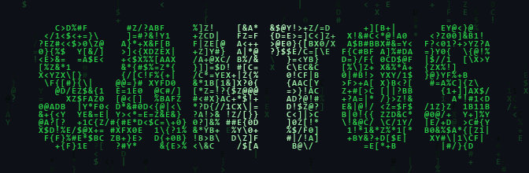

<div align="center">




</div>

<table>
<tr>
<td width="55%" valign="top">

```console
santos@br:~$ whoami
> just a kid from brazil who opens devtools
  on every site he visits

santos@br:~$ cat about.txt
> makes roblox games (luau)
> writes discord bots that sometimes work
> vibecodes at 3am, debugs at 4am
> pokes at things to see how they break
> future comp sci student, hopefully

santos@br:~$ ls skills/
python  java  luau  sql  php  html  css

santos@br:~$ sudo make me a senior dev
> santos is not in the sudoers file.
  this incident will be reported.
```

</td>
<td width="45%" align="center">

</td>
</tr>
</table>

---

### 

<p align="left">
  
</p>

### 

```diff
+ discord bots with discord.py, async everything
+ roblox games: scripting, systems, dumb ideas that become games
+ learning java properly (OOP, not copy paste)
- sleeping
- touching grass
```

### 

```
[x] made a bot that actually stayed online for a week
[x] shipped a roblox game someone other than me played
[ ] learn C and understand what a pointer really is
[ ] build something people use every day
[ ] get into ciência da computação
```

---

### 

<div align="center">
  
  <br/>
  
</div>

---

<div align="center">

> *"Who looks outside, dreams; who looks inside, awakes."* — Carl Jung

<a href="https://discordapp.com/users/santosdev11"></a>


</div>
